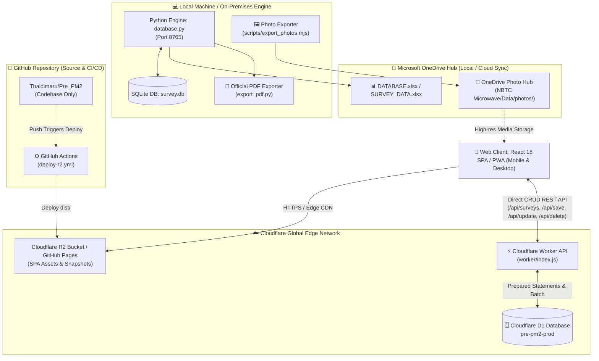

# NBTC Microwave — Pre-PM (Pre-Preventive Maintenance) Survey Control Room


> เวอร์ชันที่ใช้งานจริงอ้างอิงจาก [`src/version.js`](src/version.js) (Single Source of Truth) และดูรายละเอียดประวัติการอัปเดตทั้งหมดได้ใน [`CHANGELOG.md`](CHANGELOG.md)

ระบบศูนย์ควบคุมและบันทึกข้อมูลการเข้าตรวจเยี่ยมเจ้าของพื้นที่สำหรับงานบำรุงรักษาเชิงป้องกันล่วงหน้า (Pre-Preventive Maintenance) สถานีวิทยุคมนาคม NBTC Microwave

---

## 📋 ภาพรวมโครงการ (Project Overview)

**Pre-PM Survey Control Room** ออกแบบขึ้นเพื่ออำนวยความสะดวกแก่วิศวกรและช่างเทคนิคภาคสนามในการลงพื้นที่สำรวจสถานีวิทยุคมนาคม (NBTC Microwave) ทั่วประเทศ ครอบคลุมการตรวจสอบสิทธิ์การเข้าพื้นที่ บันทึกสภาพอุปกรณ์ ระบบไฟฟ้า เสาและสายอากาศ การจัดเก็บภาพถ่าย และสรุปผลรายงานเข้าสู่ศูนย์กลางแบบเรียลไทม์

ระบบขับเคลื่อนด้วยสถาปัตยกรรม **Modern Edge Data Hub & Tri-Cloud Architecture**:
1. **Cloudflare D1 Relational SQL Database & Workers Edge API (Zero GitHub Commits)**:
   - จัดการข้อมูลแบบสำรวจผ่าน Relational SQL Database (`pre-pm2-prod`) บน Cloudflare Edge Network โดยตรง
   - **Decoupled from Git**: ยกเลิกการคอมมิตไฟล์ JSON เข้า GitHub Repository โดยอัตโนมัติ ช่วยแก้ปัญหาคิว Build/Deploy ของ GitHub Actions และขจัดปัญหา GitHub API Rate Limit (403 Forbidden) โดยสิ้นเชิง
   - รองรับ ETag 304 Caching ผ่านตาราง `meta_sync` ช่วยลดปริมาณการอ่านแถวข้อมูล (Rows Read) และประหยัดแบนด์วิดท์
2. **Cloudflare R2 & GitHub Pages Edge Hosting**:
   - โฮสต์เว็บแอปพลิเคชัน Single Page Application (SPA / PWA) ความเร็วสูงระดับ Edge CDN ทั่วประเทศ
   - รองรับการสร้าง Static Snapshot อัตโนมัติ (`/api/dashboard`, `/api/database`) เพื่อรองรับการทำงานแบบออฟไลน์
3. **Microsoft OneDrive Photo Hub & On-Premises Engine**:
   - จัดเก็บภาพถ่ายความละเอียดสูงทั้งหมดเข้าสู่ Microsoft OneDrive Hub (`OneDrive/NBTC Microwave/Data/photos/`)
   - **Zero Base64 in Database**: แยกเฉพาะ Metadata รูปภาพบันทึกลง D1 ช่วยลดขนาดข้อมูลแบบสำรวจลงกว่า 98.9% (จาก ~32 MB เหลือเพียง ~300 KB)
   - รองรับเครื่องมือสร้างรายงานระดับทางการ (A4 PDF & Archive Export) และ SQLite Local Engine (`database.py`) สำหรับประมวลผลในเครื่อง

---

## ✨ ฟีเจอร์หลัก (Key Features)

### 1. 📊 Survey Control Room Dashboard (ศูนย์ควบคุมงานสำรวจ)
- **Live Statistics & KPIs**: สรุปตัวเลขผลสำรวจรวม, จำนวนสถานีทั้งหมดในฐานข้อมูล, สถิติการได้รับอนุญาต / ไม่อนุญาตเข้าพื้นที่
- **Provincial Heatmap / Bar Chart**: กราฟแสดงสถิติการสำรวจแยกตามจังหวัดแบบเรียลไทม์
- **High-Speed Edge Polling**: ตรวจสอบการเปลี่ยนแปลงข้อมูลผ่าน Cloudflare D1 / Worker และ Local Cache พร้อม ETag 304 Caching
- **Instant Cross-Tab Sync**: อัปเดตข้อมูลข้ามแท็บเบราว์เซอร์ทันทีผ่าน `BroadcastChannel`

### 2. 📝 Field Visit / Site Record (แบบบันทึกการเข้าตรวจเยี่ยม 7 ขั้นตอน)
- **01 ข้อมูลสถานี (Station Info)**: ดึงรายชื่อสถานีและสถานที่ติดตั้งจากฐานข้อมูล (`DATABASE.xlsx` และตาราง `stations`) แบบ Datalist Auto-complete
- **02 ผู้ให้ข้อมูลในพื้นที่ (Local Informant)**: บันทึกชื่อ, ตำแหน่ง, หน่วยงาน/หมู่บ้าน และเบอร์โทรศัพท์ติดต่อ
- **03 การขออนุญาตเข้าพื้นที่ (Site Access Permit)**: ระบุผลการขออนุญาต (อนุญาต/ไม่อนุญาต) และข้อจำกัดในการเข้าพื้นที่
- **04 สอบถามการใช้งาน (Radio & Power Status)**: ประเมินการใช้งานเครื่องวิทยุ, ปัญหาการรับ/ส่งสัญญาณ, ปัญหาระบบไฟฟ้า และระบบแบตเตอรี่สำรอง
- **05 สภาพแวดล้อมหน้างาน (Site Environment)**: บันทึกสภาพตู้ติดตั้งอุปกรณ์, สภาพเสาและสายอากาศที่มองเห็นได้จากพื้นดิน, อุปสรรคในการปฏิบัติงาน
- **06 ภาพถ่ายก่อนดำเนินงาน (Photo Documentation)**: พรีวิวภาพถ่ายทันทีผ่าน Object URL บันทึกเฉพาะ metadata และเชื่อมโยงเข้าสู่ OneDrive Hub (ปลอด Base64)
- **07 ยืนยันข้อมูล (Sign-off & Confirmation)**: สรุปสิ่งที่ได้รับแจ้ง พร้อมบันทึกชื่อผู้ให้ข้อมูลและช่างผู้ปฏิบัติงาน

### 3. 🔐 ความปลอดภัยและการบริหารระบบ (Security & Management)
- **Zero-Client Token Workflow**: เจ้าหน้าที่ภาคสนามบันทึกและแก้ไขข้อมูลได้ทันทีผ่าน Cloudflare Worker Edge API โดยไม่ต้องกรอก GitHub Personal Access Token บนอุปกรณ์แต่ละเครื่อง
- **Security Passcode Protection**: หน้าต่างการตั้งค่าระบบ (`SettingsModal`) ถูกปกป้องด้วยรหัสผ่านความปลอดภัย (Admin Passcode) เพื่อป้องกันการเข้าถึงส่วนควบคุมโดยไม่ได้รับอนุญาต
- **OneDrive Management Hub**: รวมศูนย์การจัดการโฟลเดอร์ภาพถ่ายและการสำรองข้อมูล Microsoft OneDrive ในหน้าต่างเดียว
- **PII Scrubbing Automation**: กรองและปกปิดข้อมูลส่วนบุคคลที่ละเอียดอ่อนบน Edge CDN และ Static Snapshots โดยอัตโนมัติ

---

## 🏗️ โครงสร้างสถาปัตยกรรม (Architecture)



---

## 📁 โครงสร้างโปรเจกต์ (Project Structure)

```text
Pre-PM2/
├── src/
│   ├── components/
│   │   ├── auth/              # LoginView.jsx
│   │   ├── dashboard/         # DashboardView, KpiCards, ProvinceChart, SurveyDonut, RecentSurveys
│   │   ├── field/             # FieldVisitView.jsx (7-step survey form with Object URL preview)
│   │   ├── settings/          # SettingsModal.jsx (OneDrive Hub & Admin Passcode)
│   │   ├── ui/                # Radix UI primitives & custom components
│   │   ├── Navbar.jsx         # Live Header, Clock, Real-time Status & Settings trigger
│   │   └── Sidebar.jsx        # Navigation sidebar
│   ├── lib/
│   │   ├── api.js             # Client API layer (Cloudflare D1 Worker CRUD, ETag Polling, BroadcastChannel)
│   │   └── utils.js           # clsx + tailwind-merge helper (cn)
│   ├── App.jsx                # SPA Shell, Routing, Session state
│   ├── index.css              # Tailwind CSS 4.0 Theme & Tokens
│   ├── main.jsx               # Vite Entry Point
│   └── version.js             # Single Source of Truth for Application Version
├── worker/
│   └── index.js               # Cloudflare Worker Edge API & D1 Database Router
├── migrations/
│   ├── 0001_initial_schema.sql # D1 Target Schema (surveys, survey_photos, stations, meta_sync)
│   └── 0002_seed_data.sql     # Seed Data Migration for D1 Database
├── schema.sql                 # DDL Script & Sample Prepared SQL Queries for D1
├── scripts/
│   ├── run-wrangler.cjs       # Cross-platform Wrangler CLI Runner
│   ├── d1_etl_export.mjs      # ETL Tool: Extract JSON/Excel to D1 SQL Seed
│   ├── export_photos.mjs      # Photo Export to OneDrive Hub
│   ├── build_static_snapshots.mjs # Static Snapshot Generator for Offline / CDN
│   └── pii_scan.py            # Automated PII Scanner & Compliance Checker
├── tests/
│   ├── test_cloudflare_d1_crud.mjs # D1 Direct CRUD Verification Suite
│   └── test_cloudflare_worker_proxy.mjs # Worker Proxy Verification
├── wrangler.toml              # Cloudflare Worker & D1 Binding Configuration
├── database.py                # Standalone Python 3 + SQLite Server & Local API Engine
├── deploy_r2.py               # Cloudflare R2 Frontend Deployment Tool
├── export_photos.py           # Photo export utility from SQLite
├── export_pdf.py              # Official NBTC A4 PDF Report Generation Utility
├── DATABASE.xlsx              # Master Station Records
├── vite.config.mjs            # Vite configuration + API Proxy setup
└── package.json               # Node.js dependencies, engines, and scripts
```

---

## 🚀 การติดตั้งและใช้งาน (Getting Started)

### ข้อกำหนดของระบบ (Prerequisites)
- **Node.js**: เวอร์ชัน `>= 24.0.0`
- **Python**: เวอร์ชัน `3.9+` พร้อมโมดูลใน `requirements.txt`

### 1. การพัฒนาและทดสอบระบบ Frontend (Vite Dev Server)

```bash
# ติดตั้ง Dependencies
npm install

# เริ่มต้น Vite Development Server
npm run dev

# สร้าง Production Bundle พร้อม Static Snapshots
npm run build

# ทดสอบรัน Production Bundle แบบพรีวิว
npm run preview
```

### 2. การจัดการฐานข้อมูล Cloudflare D1 Database

```bash
# รัน Migration สคีมาฐานข้อมูลบน Local D1
npm run d1:migrate:local

# รัน Migration สคีมาฐานข้อมูลบน Cloudflare D1 Production
npm run d1:migrate:remote

# นำเข้าข้อมูล Seed ลง Local D1
npm run d1:seed:local

# นำเข้าข้อมูล Seed ลง Cloudflare D1 Production
npm run d1:seed:remote

# รัน ETL สกัดข้อมูลแบบสำรวจเดิมเป็น SQL Seed
npm run etl:d1
```

### 3. การรัน Local Backend (Python + SQLite)

```bash
# เริ่มต้นเซิร์ฟเวอร์ Local Python Engine
npm start
# หรือ
python database.py
```
- เปิดเบราว์เซอร์ไปยัง `http://localhost:8765` หรือใช้งานควบคู่กับ `npm run dev` ที่พอร์ต `5173`

### 4. การ Deploy สู่ Cloudflare R2

```bash
# อัปโหลด Bundle และ Assets ขึ้น Cloudflare R2
npm run deploy
# หรือ
python deploy_r2.py
```
- หรือเมื่อ push โค้ดขึ้น branch `main` ระบบ GitHub Actions จะทำการ build และ deploy ขึ้น R2 อัตโนมัติ

---

## 📄 การส่งออกเอกสารรายงานและรูปภาพ (Export Reports & Media)

- **Official PDF Report (รายงานฉบับทางการ A4)**:
  ```bash
  npm run export:pdf
  ```
- **Archive All Reports (จัดเก็บไฟล์รวมเล่ม)**:
  ```bash
  npm run export:archive
  ```
- **ภาพถ่ายหน้างานสู่ OneDrive Hub (Photos Export)**:
  ```bash
  npm run export:photos
  ```
- **สเปรดชีต Excel (.xlsx)**:
  - สามารถดาวน์โหลดได้ทันทีจากหน้า Dashboard ผ่านปุ่ม "Export Excel"

---

## 🧪 การทดสอบระบบ (Testing & Verification)

```bash
# ทดสอบความถูกต้องของ Cloudflare D1 Direct CRUD
node tests/test_cloudflare_d1_crud.mjs

# ทดสอบ Cloudflare Worker Proxy Endpoints
node tests/test_cloudflare_worker_proxy.mjs

# ทดสอบความคงทนของการตั้งค่าระบบ (Settings Persistence)
node tests/test_settings_persistence.mjs

# ทดสอบ Python Unit Tests
npm run test:py
```

---

## 🌐 ลิงก์และข้อมูลการเผยแพร่ (Deployments & Repositories)

- **Production Edge (Cloudflare R2)**: [https://pub-bc30fda8b7654fa09add325ab0f468e0.r2.dev/dashboard](https://pub-bc30fda8b7654fa09add325ab0f468e0.r2.dev/dashboard)
- **GitHub Pages**: [https://Thaidimaru.github.io/Pre_PM2/](https://Thaidimaru.github.io/Pre_PM2/)
- **Repository**: [https://github.com/Thaidimaru/Pre_PM2](https://github.com/Thaidimaru/Pre_PM2)