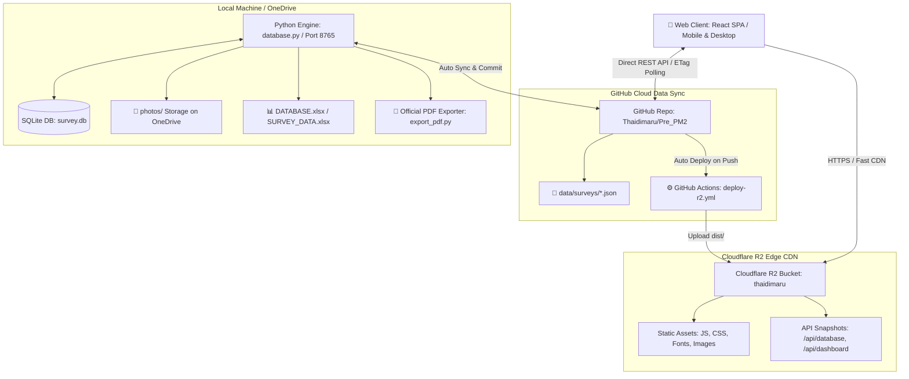

# NBTC Microwave — Pre-PM (Pre-Preventive Maintenance) Survey Control Room


> เวอร์ชันที่ใช้ได้จริงอ่านจาก `src/version.js` (Single Source of Truth) และประวัติการแก้ดูใน [`CHANGELOG.md`](CHANGELOG.md)

ระบบศูนย์ควบคุมและบันทึกข้อมูลการเข้าตรวจเยี่ยมเจ้าของพื้นที่สำหรับงานบำรุงรักษาเชิงป้องกันล่วงหน้า (Pre-Preventive Maintenance) สถานีวิทยุคมนาคม NBTC Microwave

---

## 📋 ภาพรวมโครงการ (Project Overview)

**Pre-PM Survey Control Room** ได้รับการออกแบบขึ้นมาเพื่ออำนวยความสะดวกให้แก่วิศวกรและช่างเทคนิคภาคสนามในการลงพื้นที่สำรวจสถานีวิทยุคมนาคม (NBTC Microwave) โดยครอบคลุมตั้งแต่การตรวจสอบสิทธิ์การเข้าพื้นที่ บันทึกสภาพอุปกรณ์ ตรวจสอบระบบสื่อสาร ระบบไฟฟ้า เสาอากาศ ตลอดจนการถ่ายภาพและสรุปผล เพื่อส่งข้อมูลเข้าสู่ส่วนกลางแบบเรียลไทม์

ระบบขับเคลื่อนด้วยสถาปัตยกรรม **Tri-Cloud Architecture (Cloudflare + GitHub + OneDrive)**:
1. **Cloudflare R2**: โฮสต์แอปพลิเคชัน Single Page Application (SPA / PWA) ความเร็วสูงระดับ Edge CDN ทั่วประเทศ
2. **GitHub Repository (`Thaidimaru/Pre_PM2`)**: ศูนย์กลางจัดเก็บและซิงค์ข้อมูลแบบสำรวจ (`data/surveys/*.json`) แบบ Real-time zero rate-limit polling พร้อม CI/CD Actions
3. **OneDrive / On-Premises Engine**: จัดเก็บรูปถ่ายความละเอียดสูง (`photos/`), ฐานข้อมูล SQLite (`survey.db`), และ Master Excel (`DATABASE.xlsx`) ในเครื่องอย่างปลอดภัยโดยไม่เปลืองโควตา Cloudflare R2

---

## ✨ ฟีเจอร์หลัก (Key Features)

### 1. 📊 Survey Control Room Dashboard (ศูนย์ควบคุมงานสำรวจ)
- **Live Statistics**: สรุปตัวเลขผลสำรวจรวม, จำนวนสถานีทั้งหมดในฐานข้อมูล, สถิติการได้รับอนุญาต / ไม่อนุญาตเข้าพื้นที่
- **Provincial Heatmap / Bar Chart**: กราฟแสดงสถิติการสำรวจแยกตามจังหวัดแบบเรียลไทม์
- **Real-time Live Polling**: อัปเดตข้อมูลอัตโนมัติทุก 10 วินาที พร้อมตัวนับถอยหลังและ ETag Check (ไม่กินโควตา GitHub API)
- **Instant Cross-Tab Sync**: อัปเดตข้อมูลข้ามแท็บเบราว์เซอร์ทันทีผ่าน `BroadcastChannel`

### 2. 📝 Field Visit / Site Record (แบบบันทึกการเข้าตรวจเยี่ยม)
- **01 ข้อมูลสถานี (Station Info)**: ดึงรายชื่อสถานีและสถานที่ติดตั้งจากฐานข้อมูล (`DATABASE.xlsx`) แบบ Datalist Auto-complete
- **02 ผู้ให้ข้อมูลในพื้นที่ (Local Informant)**: บันทึกชื่อ, ตำแหน่ง, หน่วยงาน/หมู่บ้าน และเบอร์โทรศัพท์ติดต่อ
- **03 การขออนุญาตเข้าพื้นที่ (Site Access Permit)**: ระบุผลการขออนุญาต (อนุญาต/ไม่อนุญาต) และข้อจำกัดในการเข้าพื้นที่
- **04 สอบถามการใช้งาน (Radio & Power Status)**: ประเมินการใช้งานเครื่องวิทยุ, ปัญหาการรับ/ส่งสัญญาณ, ปัญหาระบบไฟฟ้า และระบบแบตเตอรี่สำรอง
- **05 สภาพแวดล้อมหน้างาน (Site Environment)**: บันทึกสภาพตู้ติดตั้งอุปกรณ์, สภาพเสาและสายอากาศที่มองเห็นได้จากพื้นดิน, อุปสรรคในการปฏิบัติงาน
- **06 ภาพถ่ายก่อนดำเนินงาน (Photo Documentation)**: อัปโหลดและบันทึกภาพถ่ายหน้างานหลายไฟล์พร้อมกัน
- **07 ยืนยันข้อมูล (Sign-off & Confirmation)**: สรุปสิ่งที่ได้รับแจ้ง พร้อมบันทึกชื่อผู้ให้ข้อมูลและช่างผู้ปฏิบัติงาน

### 3. 🔐 ความปลอดภัยและการเข้าถึง (Security & Access Control)
- **Token Management**: รองรับการตั้งค่า GitHub Personal Access Token บนเบราว์เซอร์ผ่าน Modal บน Navbar เพื่อส่งข้อมูลขึ้น GitHub จากหน้างานได้ทันที
- **Safe Offline Storage**: เก็บรูปภาพต้นฉบับและ SQLite DB ไว้ในโฟลเดอร์ OneDrive ประหยัดแบนด์วิดท์คลาวด์ 100%

---

## 🏗️ โครงสร้างสถาปัตยกรรม (Architecture)



---

## 📁 โครงสร้างโปรเจกต์ (Project Structure)

```text
Pre-PM2/
├── src/
│   ├── components/
│   │   ├── auth/              # LoginView.jsx, GitHubTokenModal.jsx
│   │   ├── dashboard/         # DashboardView, KpiCards, ProvinceChart, SurveyDonut, RecentSurveys
│   │   ├── field/             # FieldVisitView.jsx (7-step survey record form)
│   │   ├── ui/                # Radix UI primitives & custom UI components
│   │   ├── Navbar.jsx         # Live Header, Clock, Real-time GitHub Status & Token trigger
│   │   └── Sidebar.jsx        # Navigation sidebar
│   ├── lib/
│   │   ├── api.js             # Client API service layer (Direct GitHub Sync, BroadcastChannel, Offline Fallback)
│   │   └── utils.js           # clsx + tailwind-merge helper (cn)
│   ├── App.jsx                # SPA Shell, Routing, Session state
│   ├── index.css              # Tailwind CSS 4.0 Theme & Tokens
│   ├── main.jsx               # Vite Entry Point
│   └── version.js             # Single Source of Truth for Application Version
├── .github/workflows/         # deploy-r2.yml (Automated GitHub Actions CI/CD to Cloudflare R2)
├── database.py                # Standalone Python 3 + SQLite Server & Local API Engine
├── deploy_r2.py               # Cloudflare R2 Frontend & API Snapshot Deployment Tool
├── export_photos.py           # Photo export utility from SQLite
├── export_pdf.py              # Official NBTC A4 PDF Report Generation Utility
├── DATABASE.xlsx              # Master Station Records
├── access-password.txt        # Default System Password
├── vite.config.mjs            # Vite configuration + API Proxy setup
└── package.json               # Node.js dependencies and scripts
```

---

## 🚀 การติดตั้งและใช้งาน (Getting Started)

### 1. การพัฒนาและทดสอบระบบ Frontend (Vite Dev Server)

```bash
# ติดตั้ง Dependencies
npm install

# เริ่มต้น Vite Development Server
npm run dev

# สร้าง Production Bundle
npm run build
```

### 2. การรัน Local Backend (Python + SQLite)

```bash
# รันเซิร์ฟเวอร์ Local Python Engine
python database.py
```
- เปิดเบราว์เซอร์ไปยัง `http://localhost:8765` หรือใช้งานควบคู่กับ `npm run dev` ที่พอร์ต `5173`

### 3. การ Deploy สู่ Cloudflare R2

```bash
# อัปโหลด Bundle และ API Snapshots ขึ้น Cloudflare R2
python deploy_r2.py
```
- ระบบจะอัปโหลด assets ทั้งหมดไปยัง R2 Bucket `thaidimaru` และพร้อมใช้งานบน URL:
  [https://pub-bc30fda8b7654fa09add325ab0f468e0.r2.dev/dashboard](https://pub-bc30fda8b7654fa09add325ab0f468e0.r2.dev/dashboard)
- หรือเพียงแค่ `git push origin main` ระบบ GitHub Actions จะสั่งรันและ Deploy อัตโนมัติ

---

## 📄 การส่งออกเอกสารรายงาน (Export Reports)

- **Official PDF Report**:
  ```bash
  python export_pdf.py
  ```
- **Excel Spreadsheet (.xlsx)**:
  - สามารถดาวน์โหลดได้ทันทีจากหน้า Dashboard ผ่านปุ่ม "Export Excel" ในเบราว์เซอร์
- **ภาพถ่ายหน้างาน (Photos)**:
  ```bash
  python export_photos.py
  ```

---

## 👨‍💻 พัฒนาโดย (Maintained By)

- **Project**: NBTC Microwave Field Survey & Control Room System
- **Repository**: [https://github.com/Thaidimaru/Pre_PM2](https://github.com/Thaidimaru/Pre_PM2.git)
- **Live URL**: [https://pub-bc30fda8b7654fa09add325ab0f468e0.r2.dev/dashboard](https://pub-bc30fda8b7654fa09add325ab0f468e0.r2.dev/dashboard)