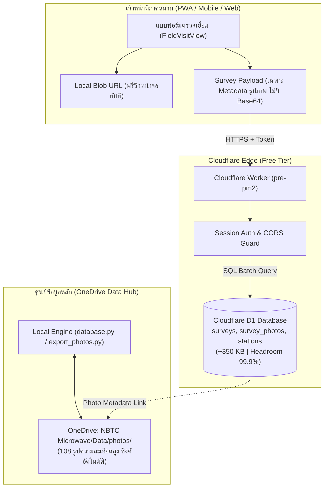

# แผนการย้ายฐานข้อมูลสู่ Cloudflare D1 (Free Tier) ร่วมกับ OneDrive Photo Hub

## Executive Summary

ปรับปรุงสถาปัตยกรรมตามทิศทางของผู้ใช้: **"จัดเก็บรูปภาพภาคสนามบน Microsoft OneDrive โดยตรง ไม่จำเป็นต้องบันทึกเป็น Base64 ฝังในไฟล์ JSON หรือฐานข้อมูล D1 อีกต่อไป"**
- **ผลลัพธ์จากการคำนวณขนาดข้อมูลจริง**:
  - เมื่อตัด Base64 ออกจากไฟล์สำรวจทั้งหมด 173 ไฟล์ ขนาดข้อมูลรวมลดลงจาก **33.3 MB เหลือเพียง 285 KB (ลดลง 99.1%)**
  - ขนาดไฟล์สำรวจเฉลี่ยอยู่ที่เพียง **1.65 KB ต่อรายการ** และรายการที่ใหญ่ที่สุดมีขนาดเพียง **4.76 KB** (ต่ำกว่าเพดาน 2 MB ของ D1 อย่างมหาศาล)
  - ฐานข้อมูลรวมทั้งระบบบน D1 (รวมตาราง `stations` และ `meta_sync`) จะใช้พื้นที่เพียง **~350 KB** คิดเป็น **0.07% ของโควตา 500 MB บน D1 Free Tier (Headroom ว่าง 99.93%)**
- **สถาปัตยกรรม OneDrive Photo Hub**:
  - ไม่จำเป็นต้องสร้างหรือผูก Cloudflare R2 เพิ่มเติม ช่วยลดความซับซ้อนและค่าใช้จ่ายคลาวด์
  - ภาพถ่ายภาคสนามทั้งหมด (ปัจจุบันมี 108 รูป) จัดเก็บและซิงค์ผ่านโฟลเดอร์ OneDrive กลาง: `OneDrive/NBTC Microwave/Data/photos/`
  - ฐานข้อมูล Cloudflare D1 จัดเก็บเฉพาะ **Metadata ของรูปถ่าย** (`name`, `fileName`, `contentType`, `fileSize`, `caption`) เพื่อใช้อ้างอิงและแสดงผล



---

## 1. การเปรียบเทียบโควตา Cloudflare D1 Free Tier (สถาปัตยกรรม OneDrive)

ข้อมูลอ้างอิงจากเอกสารทางการ [Cloudflare D1 Limits & Pricing](https://developers.cloudflare.com/d1/platform/limits/):

| ทรัพยากร | โควตา D1 Free Tier | ภาระงานจริงของระบบ (หลังตัด Base64) | สัดส่วนการใช้งาน | ประเมินความเสี่ยง |
|---|---|---|---|---|
| **Storage ต่อฐานข้อมูล** | 500 MB | **~350 KB** (รวม 180 ระเบียน + 197 สถานี) | **0.07%** | ปลอดภัยสูงสุด (เหลือ 99.93%) |
| **Storage รวมต่อบัญชี** | 5 GB (สูงสุด 10 DBs) | ~350 KB (Prod + Staging รวม < 1 MB) | 0.01% | ปลอดภัยสูงสุด |
| **ขนาดสูงสุดต่อ Row/Value** | 2,000,000 bytes (2 MB) | **4,872 bytes (4.76 KB)** | **0.24%** | **หมดปัญหาเรื่องขนาดแถวเกินถาวร** |
| **Rows Written / วัน** | 100,000 แถว/วัน | ~15–30 แถว/วัน (เฉลี่ย 10–15 writes) | 0.03% | ปลอดภัยสูง (รีเซ็ต 07:00 น. ไทย) |
| **Rows Read / วัน** | 5,000,000 แถว/วัน | ~86,000 แถว/วัน (Change-Token Polling) | 1.72% | ปลอดภัยสูง |
| **Queries / Worker Request** | 50 queries | 1–2 statements ต่อคำขอ (`batch()` รวม) | 4% | ปลอดภัย |
| **Bound Parameters / Query** | 100 parameters | ตารางหลักใช้ 9–12 parameters | 12% | ปลอดภัย |
| **Time Travel Retention** | 7 วัน | Point-in-time Restore ได้ 7 วันย้อนหลัง | ฟรี | กู้คืนฉุกเฉินได้ตลอดเวลา |
| **Worker Requests / วัน** | 100,000 requests/วัน | ~8,600 requests/วัน ต่อจอเปิดค้าง | 8.6% ต่อจอ | ปลอดภัย (มี Tab Visibility Guard) |

> [!NOTE]
> การไม่ฝัง Base64 ในไฟล์ทำให้ **ขนาด Request ขาเข้าและขาออกเล็กลงจาก 2–3 MB เหลือเพียง 3–5 KB** ส่งผลให้การเชื่อมต่อผ่านเครือข่ายมือถือ 4G/5G ภาคสนามโหลดเร็วขึ้นอย่างเห็นได้ชัด และไม่มีความเสี่ยงต่อการเกิด Worker CPU Time Timeout (เพดาน 10 ms บน Free Tier)

---

## 2. โครงสร้างฐานข้อมูล D1 (Target Schema)

ในไฟล์ Migration `migrations/0001_initial_schema.sql`:

```sql
-- 1. ตารางแบบสำรวจ (เก็บเฉพาะ Form Data และ Metadata ไร้ Base64)
CREATE TABLE IF NOT EXISTS surveys (
    record_id TEXT PRIMARY KEY,
    saved_at TEXT NOT NULL,
    updated_at TEXT NOT NULL,
    version INTEGER NOT NULL DEFAULT 1,
    station TEXT NOT NULL,
    province TEXT NOT NULL,
    permit TEXT,
    fields_json TEXT NOT NULL,
    deleted_at TEXT DEFAULT NULL
);

CREATE INDEX IF NOT EXISTS idx_surveys_updated_at ON surveys (updated_at);
CREATE INDEX IF NOT EXISTS idx_surveys_station ON surveys (station);
CREATE INDEX IF NOT EXISTS idx_surveys_deleted_at ON surveys (deleted_at);

-- 2. ตารางข้อมูลรูปถ่าย (เก็บเฉพาะ Metadata และชื่อไฟล์ที่เก็บใน OneDrive)
CREATE TABLE IF NOT EXISTS survey_photos (
    id TEXT PRIMARY KEY,
    record_id TEXT NOT NULL,
    file_name TEXT NOT NULL,
    original_name TEXT,
    content_type TEXT NOT NULL DEFAULT 'image/jpeg',
    file_size INTEGER DEFAULT 0,
    onedrive_relative_path TEXT NOT NULL,
    created_at TEXT NOT NULL,
    FOREIGN KEY (record_id) REFERENCES surveys(record_id) ON DELETE CASCADE
);

CREATE INDEX IF NOT EXISTS idx_survey_photos_record_id ON survey_photos (record_id);

-- 3. ตารางสถานีแม่ข่าย Master Station
CREATE TABLE IF NOT EXISTS stations (
    id INTEGER PRIMARY KEY,
    village TEXT NOT NULL,
    subdistrict TEXT,
    district TEXT,
    province TEXT,
    installation_place TEXT,
    equipment_place TEXT,
    contact_name TEXT,
    contact_position TEXT,
    contact_phone TEXT,
    house_no TEXT
);

CREATE INDEX IF NOT EXISTS idx_stations_province ON stations (province);

-- 4. ตาราง System Change Token สำหรับ Dashboard Polling แบบประหยัด Rows Read
CREATE TABLE IF NOT EXISTS meta_sync (
    key TEXT PRIMARY KEY,
    last_change_timestamp TEXT NOT NULL,
    change_counter INTEGER NOT NULL DEFAULT 1
);

INSERT OR IGNORE INTO meta_sync (key, last_change_timestamp, change_counter)
VALUES ('surveys', datetime('now'), 1);
```

---

## 3. แผนการจัดการรูปภาพผ่าน OneDrive Photo Hub

### 3.1 รูปแบบการอ้างอิงรูปภาพ
- ชื่อไฟล์รูปภาพในโฟลเดอร์ OneDrive ถูกตั้งตามมาตรฐาน:
  `{recordId}_{photo_name}.jpg` เช่น `PM-202610051505375-e592_photo_1.jpg`
- ใน D1 ตาราง `survey_photos` และฟิลด์ `photos[]` ใน `fields_json` จะเก็บเฉพาะโครงสร้าง:
  ```json
  {
    "id": 1,
    "name": "photo_1.jpg",
    "fileName": "PM-202610051505375-e592_photo_1.jpg",
    "contentType": "image/jpeg",
    "size": 245100,
    "url": "/photos/PM-202610051505375-e592_photo_1.jpg"
  }
  ```
  *(ฟิลด์ `data`, `dataUrl`, `base64Data` จะถูกตัดทิ้งทั้งหมด 100%)*

### 3.2 การนำเข้าภาพเดิมเข้าสู่ OneDrive (ETL Cleanup)
1. ดึงภาพ 102 ภาพที่มีในตาราง `survey_photos` (SQLite) และ 113 ภาพที่ฝังใน JSON เดิม 28 ไฟล์
2. รันสคริปต์ `export_photos.py` เพื่อให้แน่ใจว่าไฟล์รูปภาพต้นฉบับความละเอียดสูงทั้งหมด 108 รูป ถูกเซฟลงโฟลเดอร์ OneDrive (`C:\Users\utai3\OneDrive\NBTC Microwave\Data\photos`) เรียบร้อย
3. สคริปต์ ETL ทำการล้าง Base64 ออกจากไฟล์สำรวจทั้งหมดก่อนแปลงเป็นชุดคำสั่ง SQL สำหรับ D1

---

## 4. แผนการปรับปรุงโค้ด (File-by-File Code Changes)

| ไฟล์ | สถานะ | สรุปการแก้ไข |
|---|---|---|
| `src/components/field/FieldVisitView.jsx` | **MODIFY** | ไม่แปลงไฟล์รูปภาพเป็น Base64 ขนาดใหญ่เพื่อส่งเซฟ ส่งเฉพาะ Metadata รูปภาพ ส่วนการพรีวิวหน้าจอให้ใช้ `URL.createObjectURL(file)` ชั่วคราว |
| `src/lib/api.js` | **MODIFY** | ในฟังก์ชัน `submitSurvey` และ `updateSurvey` ตัดการแปลง/ฝัง Base64 ออกจาก `localSurvey` และเปลี่ยนปลายทางการบันทึกเป็น Worker D1 |
| `worker/index.js` | **MODIFY** | อัปเดต `/api/save` ให้บันทึกเฉพาะ Form Data และ Photo Metadata ลงในตาราง `surveys` และ `survey_photos` บน D1 ผ่าน `env.DB.batch()` |
| `src/components/export/SurveyReportModal.jsx` | **MODIFY** | ปรับปรุงฟังก์ชัน `getPhotoSrc()` ให้อ่านจาก `/photos/{fileName}` หรือพาธรูปในเครื่อง/OneDrive แทนการคาดหวัง Base64 string |
| `src/components/dashboard/SurveyPreviewModal.jsx` | **MODIFY** | ปรับปรุงการแสดงผลพรีวิวรูปภาพให้สอดคล้องกัน |
| `wrangler.toml` | **MODIFY** | เพิ่มเฉพาะ `[[d1_databases]]` binding (ไม่จำเป็นต้องมี `[[r2_buckets]]`) |
| `database.py` (Local Hub) | **MAINTAIN** | คงฟังก์ชันการซิงค์รูปภาพเข้าโฟลเดอร์ OneDrive `ONEDRIVE_DATA_DIR / "photos"` ตามปกติ |

### ตัวอย่างการปรับปรุง `src/lib/api.js` (ตัด Base64)
```javascript
// ปรับโครงสร้างรูปภาพให้เก็บเฉพาะ Metadata ก่อนบันทึก
const cleanPhotos = (photos || []).map((p, idx) => ({
  id: p.id || idx + 1,
  name: p.name || `photo_${idx + 1}.jpg`,
  fileName: `${recordId}_${p.name || `photo_${idx + 1}.jpg`}`,
  contentType: p.type || p.contentType || 'image/jpeg',
  size: p.size || 0,
  url: `/photos/${recordId}_${p.name || `photo_${idx + 1}.jpg`}`
}));

// ส่งบันทึกเฉพาะ Form Data และ Clean Metadata
const payload = {
  recordId,
  station: stationName,
  province,
  permit,
  fields: {
    ...cleanFields,
    photos: cleanPhotos
  },
  photos: cleanPhotos
};
```

---

## 5. การจัดการข้อมูล 7 ระเบียนที่ถูกลบใน Git

จากการตรวจสอบหลักฐานในประวัติ Git:
- `PM-202610150221060-6e32`
- `PM-202610150226369-6520`
- `PM-202610150648515-a9eb`
- `PM-202610150231413-cf0f`
- `PM-202610150222012-0d56`
- `PM-202610150234324-2e2c`
- `PM-202610150222569-646e`

ทั้ง 7 ระเบียนนี้ถูกลบจริงด้วยคำสั่ง `chore(survey): Delete Pre-PM survey...`
**แนวทางปฏิบัติในแผนนี้**:
- ใน D1 จะบันทึกทั้ง 7 ระเบียนนี้โดยกำหนดค่า `deleted_at = '2026-10-15T...'` (Soft Delete Tombstone)
- ข้อดี: ทำให้มีประวัติ Audit Trail ย้อนหลังในฐานข้อมูล และไม่ทำให้ข้อมูลผีฟื้นคืนชีพในหน้า Dashboard หรือผลการค้นหา

---

## 6. แผนการตัดถ่ายระบบและ Rollback (Cutover & Rollback)

### 6.1 ลำดับการ Cutover
1. **เตรียมความพร้อมโฟลเดอร์ OneDrive**: รัน `python export_photos.py` เพื่อตรวจสอบว่ารูปทั้ง 108 รูปใน OneDrive โฟลเดอร์ `photos/` ครบถ้วน
2. **สร้าง D1 Database**: รัน `npx wrangler d1 create pre-pm2-prod`
3. **รัน Migration Schema**: `npx wrangler d1 migrations apply pre-pm2-prod --remote`
4. **ETL Import Data**: รันสคริปต์สกัด JSON ทั้ง 173 ไฟล์ (ตัด Base64) + 7 ระเบียนที่ลบ ส่งเข้า D1
5. **ตรวจสอบความถูกต้อง (Verify)**:
   - ตรวจสอบจำนวนแถว: `surveys` = 180 (173 active + 7 deleted)
   - ตรวจสอบ Hash ของข้อมูลแต่ละสถานี
6. **Deploy Worker & Frontend**: อัปเดตโค้ดระบบและเริ่มใช้งานจริง

### 6.2 แผนการย้อนกลับฉุกเฉิน (Rollback)
- **Time Travel Restore**: กู้คืนสถานะ D1 ย้อนหลังได้สูงสุด 7 วันผ่านคำสั่ง:
  `npx wrangler d1 time-travel restore pre-pm2-prod --timestamp="2026-10-XXT..."`
- **Reverse Export**: ใช้คำสั่ง `npx wrangler d1 export pre-pm2-prod --remote --output=backup.sql` เพื่อนำข้อมูลกลับมาเป็น SQLite หรือ JSON ได้ภายในเวลาไม่เกิน 5 นาที

---

## 7. ตารางประเมินความเสี่ยงฉบับปรับปรุง (Risk Register)

| ความเสี่ยง | โอกาส | ผลกระทบ | มาตรการป้องกัน |
|---|---|---|---|
| **ขนาด Row เกิน 2 MB บน D1** | **ไม่มี (0%)** | ร้ายแรง | ตัด Base64 รูปภาพออกทั้งหมด ขนาดแถวใหญ่สุดเหลือเพียง 4.76 KB |
| **การโหลดรูปภาพในรายงาน PDF/A4 ไม่ขึ้น** | ต่ำ | ปานกลาง | ปรับ `getPhotoSrc` ให้อ่านจากพาธไฟล์ OneDrive/Local `/photos/` อย่างเป็นระบบ |
| **ข้อมูล 7 ระเบียนที่เคยลบโผล่กลับมา** | ต่ำ | ปานกลาง | มาร์ก `deleted_at` ตามประวัติ Git อย่างเคร่งครัดในสคริปต์ ETL |
| **Rows Read เกินเพดานจาก Polling** | ต่ำ | สูง | ใช้ Change Token บนตาราง `meta_sync` (อ่านเพียง 1 แถวต่อรอบการ Polling) |
| **รูปภาพภาคสนามใหม่ที่ถ่ายออฟไลน์** | ปานกลาง | ปานกลาง | เก็บรูปไว้ในเครื่องภาคสนามผ่าน IndexedDB/Cache ชั่วคราว และอัปโหลดเข้า OneDrive Hub เมื่อเชื่อมต่อระบบ |

---

## 8. ข้อสรุปและคำแนะนำ (Recommendation)

> [!TIP]
> **คำแนะนำ: GO (อนุมัติอย่างยิ่ง)**
> 
> การปรับมาใช้ **OneDrive Photo Hub** และตัด Base64 ออกจากไฟล์ ทำให้:
> 1. ปริมาณข้อมูลลดลงถึง **99.1%** เหลือเพียง **285 KB** เหมาะสมกับ Cloudflare D1 Free Tier อย่างไร้ที่ติ
> 2. ไม่ต้องพึ่งพาหรือเสียค่าใช้จ่าย Cloudflare R2 เพิ่มเติม
> 3. แก้ไขปัญหาความปลอดภัยและเพิ่มประสิทธิภาพการโหลดของระบบอย่างมีนัยสำคัญ
